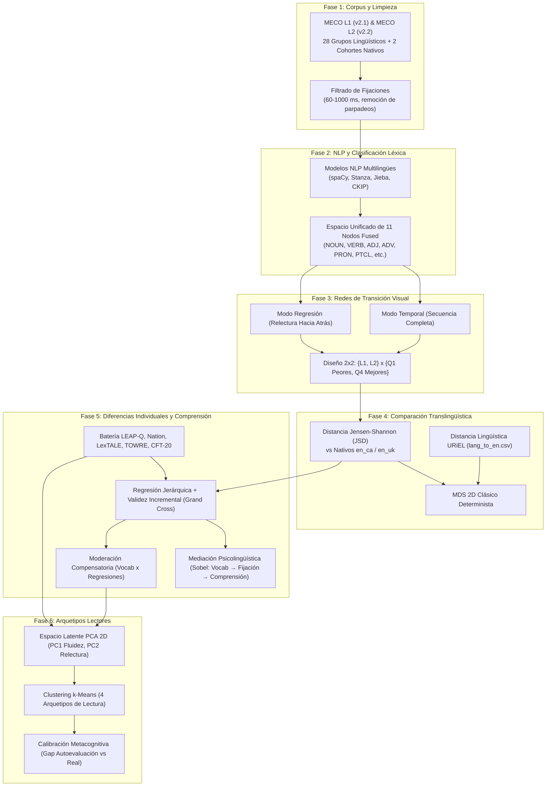

# Pipeline de Investigación: De Redes de Transición Visual a Arquetipos Cognitivos de Lectura L2
## Visión General, Arquitectura Metodológica y Mapa de Ruta

Este repositorio alberga la investigación completa que conecta la **ciencia de redes aplicada al movimiento ocular** (*eye-tracking*) con el **modelado psicométrico de diferencias individuales**, con el fin de explicar cómo lectores de distintas lenguas maternas leen y comprenden textos en inglés como segunda lengua (L2).

---

## 1. El Arco Narrativo y Científico del Proyecto

La investigación responde a tres preguntas científicas concatenadas:

```
┌────────────────────────────────────────────────────────────────────────┐
│ PREGUNTA 1 (Micro-nivel: Redes Oculares):                              │
│ ¿Cómo navegan los lectores el texto palabra por palabra?               │
│ → Modelado de transiciones entre tipos de palabras como grafos.        │
└──────────────────────────────────┬─────────────────────────────────────┘
                                   │
                                   ▼
┌────────────────────────────────────────────────────────────────────────┐
│ PREGUNTA 2 (Meso-nivel: Comparación Translingüística y Distancia):     │
│ ¿La distancia tipológica de la L1 al inglés moldea la estrategia?      │
│ ¿Los lectores más competentes leen como un nativo de inglés?           │
│ → Distancia Jensen-Shannon, MDS 2D y correlación con URiEL.           │
└──────────────────────────────────┬─────────────────────────────────────┘
                                   │
                                   ▼
┌────────────────────────────────────────────────────────────────────────┐
│ PREGUNTA 3 (Macro-nivel: Diferencias Individuales y Arquetipos):       │
│ ¿Qué determina el éxito en la comprensión lectora?                     │
│ ¿Existen perfiles cognitivos latentes de lectores bilingües?           │
│ → Mediación Sobel, Moderación Compensatoria y Clustering k-Means.      │
└────────────────────────────────────────────────────────────────────────┘
```

---

## 2. Mapa Conceptual de la Arquitectura (Pipeline End-to-End)



---

## 3. Estructura de Documentación para el Paper

La documentación se ha dividido en módulos especializados que cubren el 100% de la cadena de investigación:

| Documento | Enfoque Principal | Componentes y Archivos Clave |
| :--- | :--- | :--- |
| **[`01_DATA_PREPROCESSING_AND_CLEANING.md`](01_DATA_PREPROCESSING_AND_CLEANING.md)** | Corpus MECO, Waves 1 y 2, criterios de limpieza y calidad. | `data/`, `preprocess_fixation_data.py`, `POPEYE_DATA_SPEC.md` |
| **[`02_WORD_CLASSIFICATION_AND_NLP.md`](02_WORD_CLASSIFICATION_AND_NLP.md)** | POS tagging multilingüe, tipología léxica y espacio de 11 nodos fused. | `scripts/classify_words*.py`, `words_classified.csv` |
| **[`03_NETWORK_SCIENCE_TRANSITIONS.md`](03_NETWORK_SCIENCE_TRANSITIONS.md)** | Modelado de fijaciones como redes dirigidas y métricas de grafos. | `networks/word-type-transitions/`, modos temporal y regresión |
| **[`04_CROSS_LINGUISTIC_MDS_AND_DISTANCE.md`](04_CROSS_LINGUISTIC_MDS_AND_DISTANCE.md)** | Comparación JSD contra nativos, MDS 2D y correlación con distancia URiEL. | `networks/reading-pattern-mds/`, `lang_to_en.csv` |
| **[`05_INDIVIDUAL_DIFFERENCES_AND_MODELS.md`](05_INDIVIDUAL_DIFFERENCES_AND_MODELS.md)** | Batería psicométrica, LEAP-Q, modelos jerárquicos y prueba Grand Cross. | `analysis/individual_differences/predict_comprehension.py` |
| **[`06_COGNITIVE_MECHANISMS_AND_ARCHETYPES.md`](06_COGNITIVE_MECHANISMS_AND_ARCHETYPES.md)** | Mediación Sobel, compensación por cuartiles, clustering $k$-means y PCA. | `analysis/individual_differences/advanced_multilevel_analysis.py` |
| **[`07_PAPER_STRUCTURE_AND_SYNTHESIS.md`](07_PAPER_STRUCTURE_AND_SYNTHESIS.md)** | Estructura formal sugerida para redactar el paper científico / tesis. | Abstract, Introducción, Métodos, Resultados, Discusión |
| **[`FIGURES_AND_OUTPUTS_CATALOG.md`](FIGURES_AND_OUTPUTS_CATALOG.md)** | Catálogo completo de imágenes generadas (300 DPI) y tablas de datos. | `output/plots/`, descripciones y leyendas de figuras |

---

## 4. Hallazgos Nucleares Listos para Citar en el Paper

1. **La cercanía al patrón de lectura nativo es un marcador de comprensión en L2:**
   - La distancia de transición visual hacia lectores nativos de inglés correlaciona significativamente con la comprensión en L2 ($r = +0.43, p = 0.029$; en lectores con dificultades Q1, $r = +0.59, p = 0.0015$). En L1 nativo esta correlación es nula ($r = -0.12, p = 0.557$), confirmando que la cercanía visual es un marcador específico de competencia en segunda lengua.
2. **La distancia lingüística de la L1 deja una huella estructural:**
   - En la lectura nativa L1, la distancia lingüística URiEL predice fuertemente la divergencia respecto al patrón inglés ($r \approx 0.63 - 0.71, p < 0.001$). Al leer en inglés (L2), los lectores convergen hacia el patrón anglosajón, aunque los lectores más avanzados retienen una sutil firma de su lengua materna ($r = 0.44, p < 0.03$).
3. **Validez predictiva incremental del Eye-Tracking (Grand Cross):**
   - El eye-tracking no es un simple correlato estático: añadir métricas oculomotoras a un modelo que ya controla por antecedentes sociodemográficos, inteligencia fluida y batería léxica añade varianza explicada adicional estadísticamente significativa ($\Delta R^2 = 1.0\%, p = 0.003$, caída en AIC).
4. **Mecanismo de Mediación Léxico-Ocular:**
   - El $21.6\%$ del impacto positivo del vocabulario en la comprensión lectora ocurre de forma indirecta al reducir el tiempo de fijación ocular sobre las palabras (Sobel $Z = 3.702, p = 0.00021$).
5. **Mecanismo Compensatorio (Relectura Selectiva):**
   - Existe una interacción significativa entre vocabulario y regresiones ($\beta = -0.108, p < 0.0001$). Releer y monitorear activamente solo mejora la comprensión en lectores con bajo vocabulario (Cuartil 1: $\beta = +0.844, p = 0.0001$). En lectores avanzados (Q2 a Q4), la pendiente es plana ($p > 0.25$).
6. **Existencia de 4 Arquetipos de Lectura Bilingüe:**
   - Un espacio latente bidimensional (PC1: Proficiencia/Velocidad, 47.3% varianza; PC2: Relectura/Monitoreo, 18.6% varianza) segmenta a los lectores en 4 clusters empíricos estables: *Nativoide/Eficiente* ($27.7\%$), *Estratégico/Compensador* ($23.7\%$), *Intermedio/Moderado* ($32.2\%$) y *Bloqueado/Dificultad* ($16.4\%$).

